<div align="center">

# arcOS

**Un sistema operativo per PC x86-64 scritto da zero.**

Boot loader, kernel, file system, driver, interfaccia grafica e linguaggio
di programmazione: tutto progettato apposta, in Rust, senza librerie esterne.

[**Scarica l'ultima versione**](https://github.com/matthias-peterlini/ArcOs/releases/latest) ·
[Documentazione](docs/) ·
[Architettura](docs/architettura.md) ·
[Compatibilità](docs/compat.md)

[](https://github.com/matthias-peterlini/ArcOs/actions/workflows/build.yml)

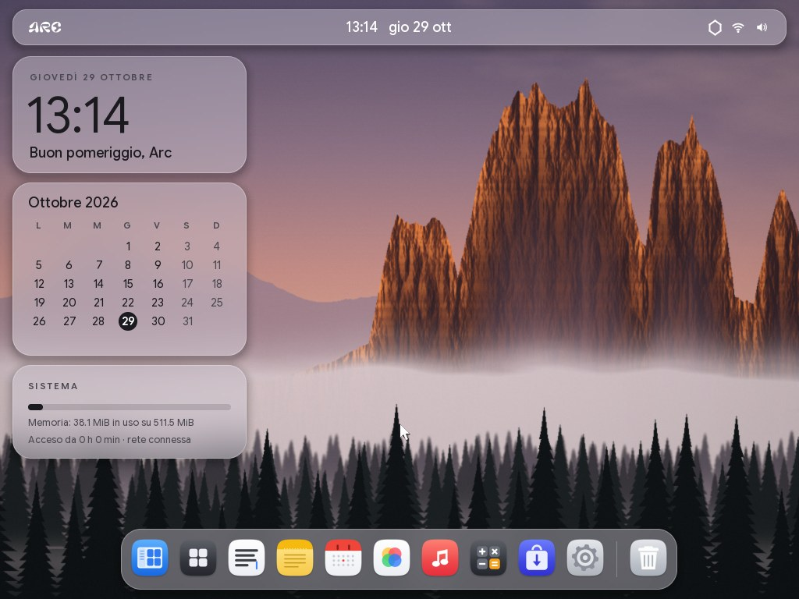

</div>

## In breve

- **Si avvia ovunque**: la stessa immagine parte da BIOS e da UEFI, da
  chiavetta USB, da disco o come CD live.
- **Un avvio pulito**: niente righe di testo, solo il logo e una barra di
  caricamento. Al primo avvio una configurazione guidata (nome, tastiera,
  sfondo), poi direttamente la scrivania.
- **Lo stile arc**: una barra flottante in vetro chiaro (logo, ora e data,
  stato), finestre con il titolo integrato e tre pulsanti tondi, un dock
  flottante, il centro di controllo (rete, suono, non disturbare, sfondo,
  volume, luminosità, account) e il centro notifiche con il calendario. A
  schermo intero (F11) la barra si aggancia in alto e porta con sé il nome
  dell'app e i suoi pulsanti. Il carattere è Google Sans Flex; icone,
  suoni e musica sono creati per arcOS; tra gli sfondi ci sono foto delle
  Dolomiti da Wikimedia Commons (autori e licenze in
  `rootfs/system/gui/wallpapers/CREDITS.txt`).
- **Al sicuro e aggiornato**: una password blocca lo schermo (all'avvio,
  con logo+L o dopo qualche minuto di pausa), Stamp salva una schermata in
  Immagini, e arcOS avvisa quando su GitHub c'è una versione nuova.
- **Doppio clic e via**: un programma parte, un pacchetto (`.deb`,
  `.tar.gz`, `.zip`, `.pkg` di macOS…) si installa da solo.
- **Le app di ogni giorno**: File, Editor di testo, Note, Promemoria,
  Calendario, Orologio, Calcolatrice, Foto, Musica, Monitor attività.
- **L'ecosistema ticly**: ticly Do (attività, note, calendario), ticly AI
  (in anteprima: le risposte non sono ancora collegate) e il ticly browser,
  con un unico account ticly salvato sul computer; il browser usa un motore
  web (HTML, CSS, immagini) scritto da zero.
- **Un Negozio con app vere**: giochi (2048, Campo minato, Serpente, Sudoku,
  Tris) e Disegno, programmi separati che si installano con un clic e aprono
  le loro finestre.
- **I driver si installano da soli**: dischi SATA e NVMe, USB 1/2/3,
  schede di rete Intel e Realtek, lettori di schede SD, audio HD e AC'97,
  schede video delle macchine virtuali con cambio di risoluzione, e lo
  schermo su ogni altra scheda (Intel, AMD, NVIDIA).
- **Esegue programmi Linux, Windows e Android** senza modificarli, accanto
  ai suoi: Linux x86-64 statici, Windows x64 da console e con finestre,
  programmi Java e app Android (`.apk`, `.dex`) che costruiscono
  l'interfaccia nel codice. Le app macOS non possono girare; i limiti sono
  in [compatibilità](docs/compat.md#cosa-non-può-girare).
- **Ha il suo linguaggio**, ArcScript, con compilatore e macchina virtuale
  che girano su arcOS.
- **Scritto da zero**: niente codice di Linux, Unix, DOS o Windows, nessuna
  crate di terze parti. Solo il compilatore Rust e `core`/`alloc`.

## Com'è

<table>
<tr>
<td width="50%">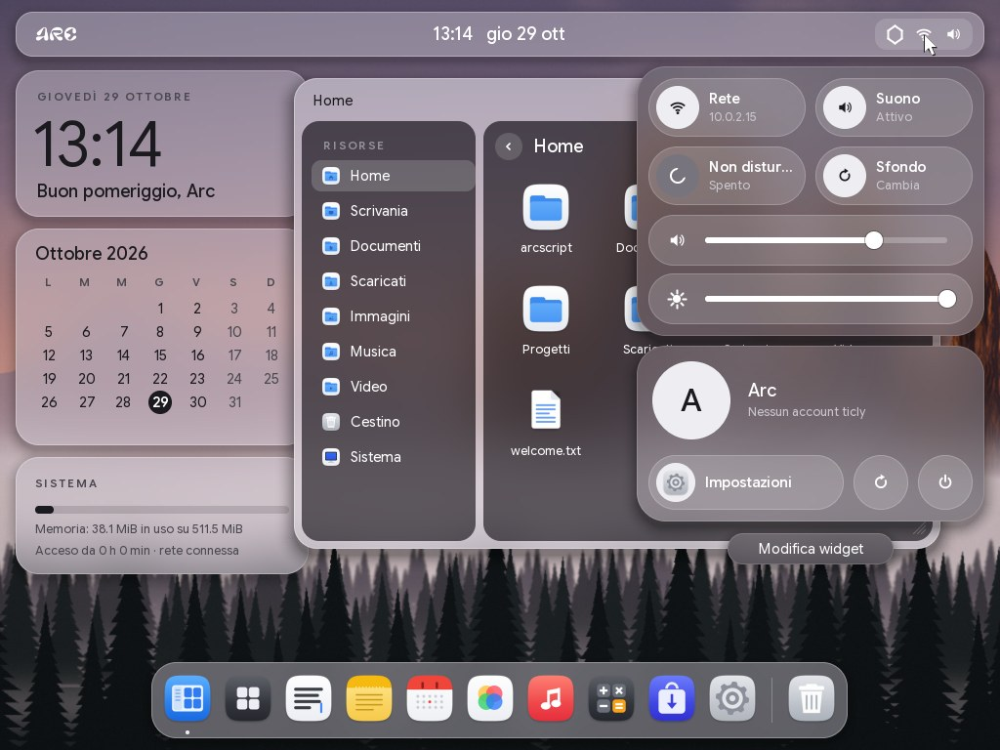<br><b>Centro di controllo</b>: riquadri, volume, luminosità e account.</td>
<td width="50%">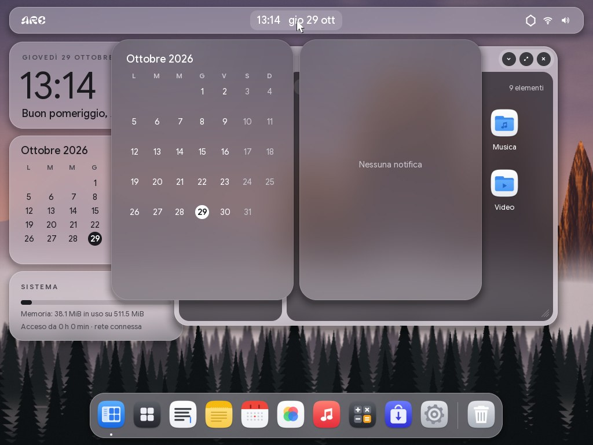<br><b>Centro notifiche</b>: il calendario e le notifiche ricevute.</td>
</tr>
<tr>
<td>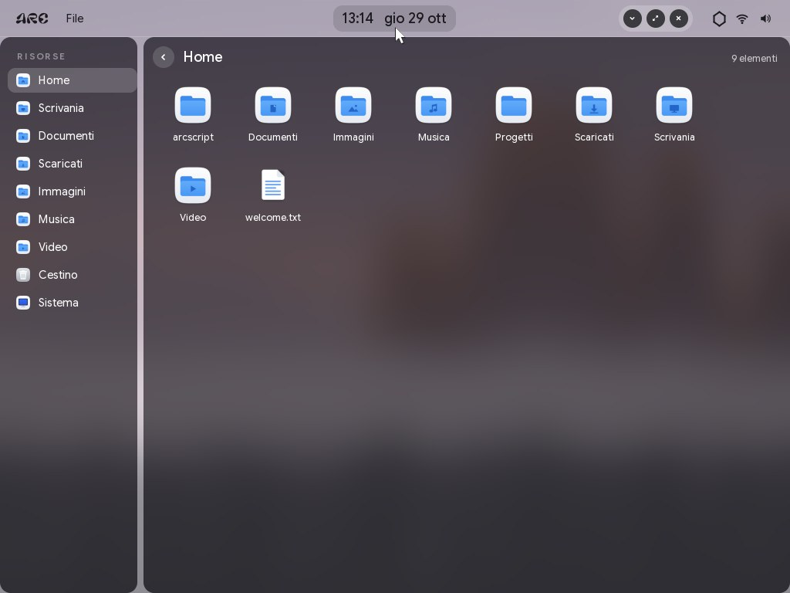<br><b>Schermo intero</b>: la barra si aggancia con il nome dell'app.</td>
<td>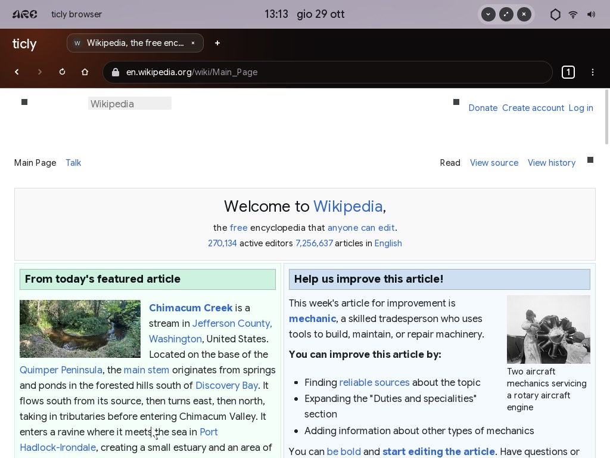<br><b>ticly browser</b>: Wikipedia con il motore web di arcOS.</td>
</tr>
<tr>
<td width="50%">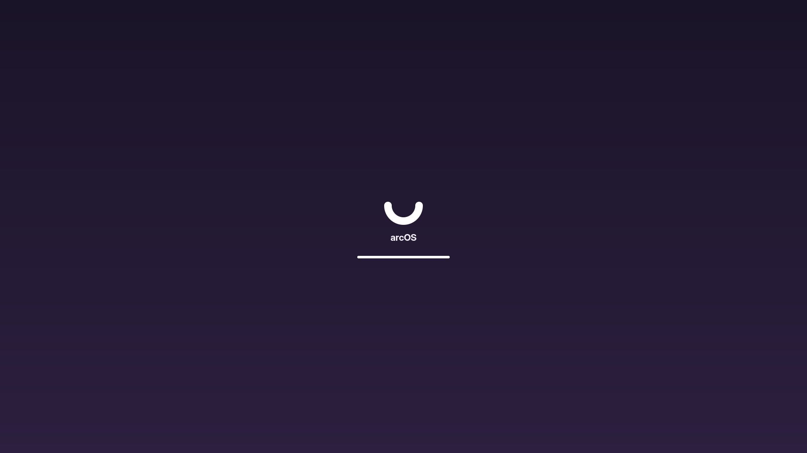<br><b>Avvio</b>: solo il logo e una barra di caricamento.</td>
<td width="50%">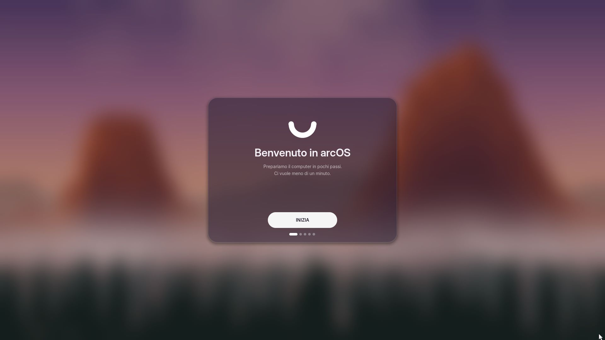<br><b>Primo avvio</b>: la configurazione guidata parte con INIZIA.</td>
</tr>
<tr>
<td>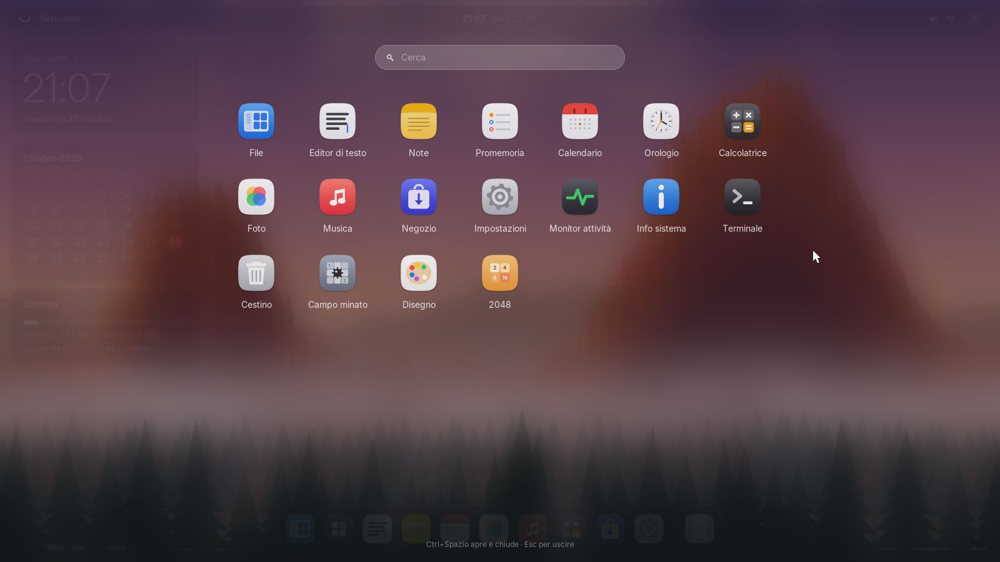<br><b>Applicazioni</b>: tutte le app, con ricerca (Ctrl+Spazio).</td>
<td>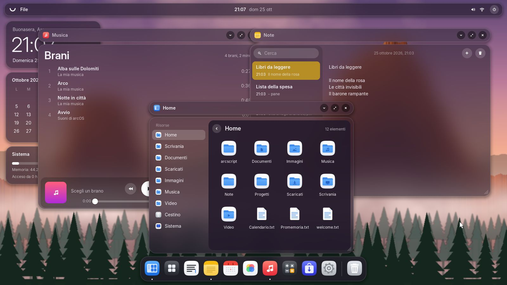<br><b>Finestre</b>: Musica, Note e File insieme.</td>
</tr>
<tr>
<td>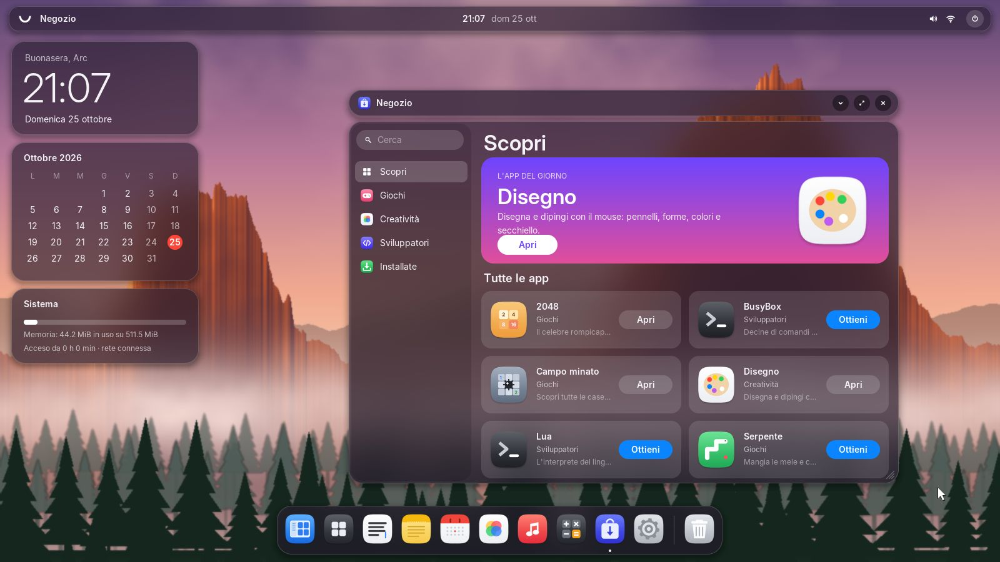<br><b>Negozio</b>: giochi e app, installati con un clic.</td>
<td>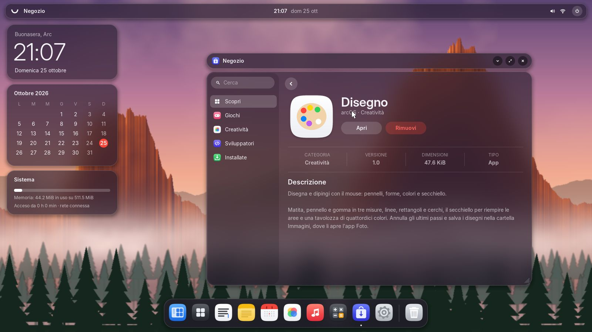<br><b>La pagina di un'app</b>: descrizione, versione, dimensioni.</td>
</tr>
<tr>
<td>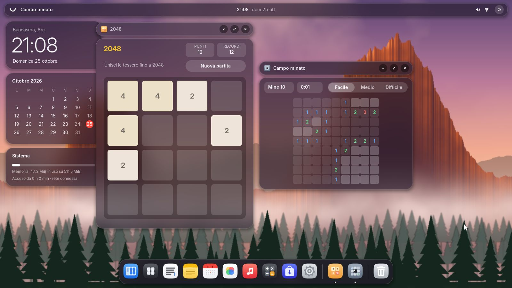<br><b>Giochi</b>: 2048 e Campo minato, programmi del Negozio.</td>
<td>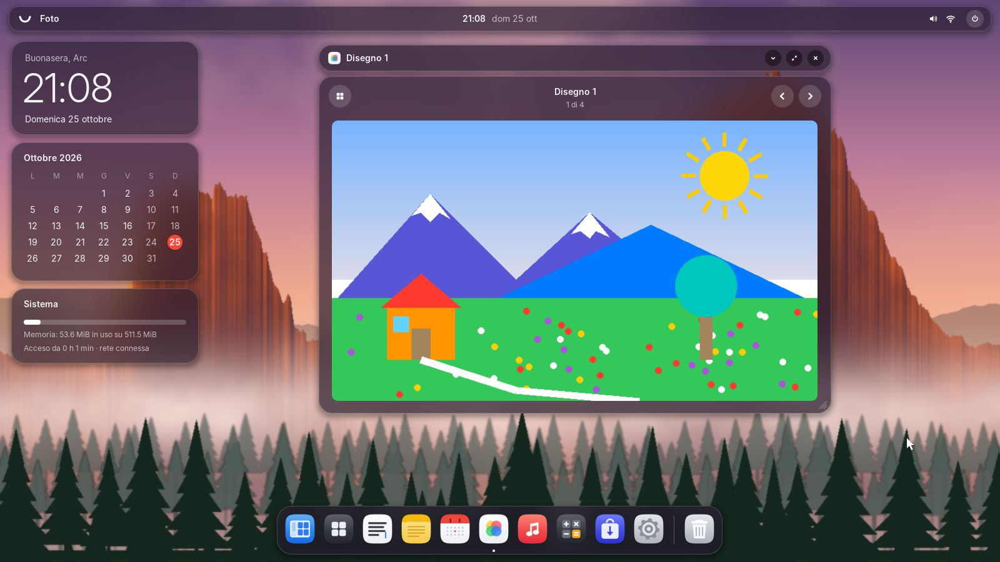<br><b>Foto</b>: un disegno fatto con l'app Disegno.</td>
</tr>
<tr>
<td>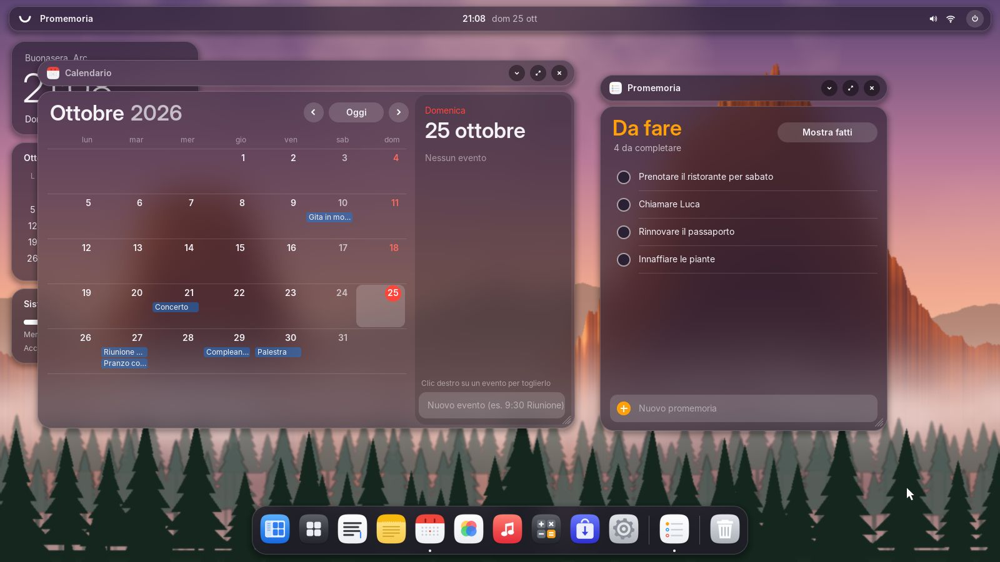<br><b>Calendario e Promemoria</b>: eventi, feste, cose da fare.</td>
<td>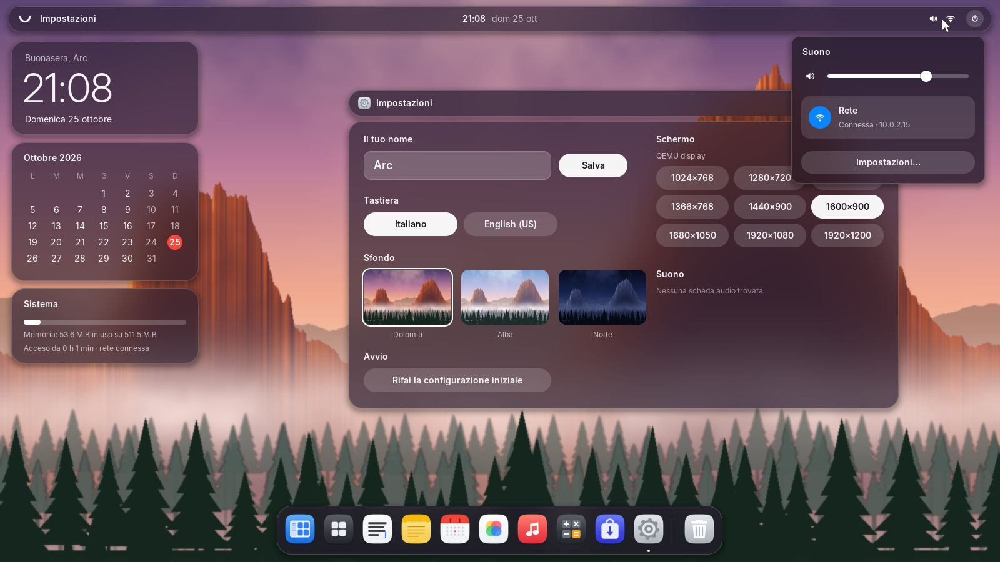<br><b>Impostazioni e centro di controllo</b>: schermo, volume, sfondo.</td>
</tr>
</table>

## Provarlo

Nelle [release](https://github.com/matthias-peterlini/ArcOs/releases)
ci sono due file:

| File | Cosa farne |
|---|---|
| `arcos.iso` | **CD live**: si avvia in una macchina virtuale (VirtualBox, VMware, QEMU) o da un CD, con BIOS o UEFI. Il sistema gira in memoria e le modifiche si perdono allo spegnimento. |
| `arcos-img.zip` | **Immagine di disco** da scrivere su una chiavetta USB (balenaEtcher, Rufus in modalità DD, `dd`) per avviare un PC vero. Secure Boot va disattivato. |

Il modo più veloce, con QEMU:

```sh
qemu-system-x86_64 -m 512M -cdrom arcos.iso -device ich9-intel-hda -device hda-output
```

In VirtualBox basta una macchina "Other/Unknown (64-bit)" con 512 MiB di
memoria e `arcos.iso` nel lettore CD.

## Cosa c'è dentro

| Parte | Cosa fa | Dettagli |
|---|---|---|
| **ArcBoot** | loader per BIOS (MBR + secondo stadio in assembly) e per UEFI (un'applicazione EFI in Rust); entrambi passano al kernel la stessa `BootInfo` | [architettura](docs/architettura.md#avvio) |
| **Kernel** | 64 bit, memoria virtuale a 4 livelli, scheduler preemptivo, thread, code di attesa, MSI/MSI-X, ACPI per spegnere e riavviare | [architettura](docs/architettura.md#kernel) |
| **Driver** | pacchetti `.adp` indipendenti dal kernel: il kernel confronta i manifesti con l'hardware e carica il driver giusto da solo, all'avvio e a sistema avviato | [driver](docs/driver.md) |
| **ArcFS** | il file system nativo: blocchi da 4 KiB, extent, controllo di coerenza; volumi con nome (`sys:`, `ram:`, `chiavetta:`) | [architettura](docs/architettura.md#file-system-arcfs) |
| **Interfaccia** | splash, configurazione guidata, scrivania con dock, Launchpad, notifiche e animazioni; quindici app di sistema | [gui](docs/gui.md) |
| **Programmi** | in modalità utente, ognuno nel suo spazio di indirizzi, a riga di comando o con finestre proprie (`arcui`) | [programmi](docs/programmi.md) |
| **Negozio** | 2048, Campo minato, Serpente, Sudoku, Tris, Disegno; BusyBox e Lua per il Terminale | [gui](docs/gui.md#il-negozio-e-le-app-installabili) |
| **Compatibilità** | eseguibili ELF statici Linux, `.exe` Windows x64 (console e finestre), programmi Java e app Android (`.dex`, `.apk`); installazione di `.deb`, `.tar.gz`, `.zip` e `.pkg` con un doppio clic | [compatibilità](docs/compat.md) |
| **ArcScript** | il linguaggio di arcOS: `arcc` compila ed esegue `.as` e pacchetti `.arc` | [ArcScript](docs/arcscript.md) |
| **Rete** | ARP, IPv4, ICMP, UDP, TCP, DHCP, DNS; TLS 1.3 con certificati verificati e HTTP(S) | |
| **Web** | `arcweb`: HTML, CSS (flexbox, grid, tabelle, media query), PNG, JPEG e GIF, per il ticly browser | [gui](docs/gui.md#il-motore-web) |
| **Shell** | una quarantina di comandi, cronologia, completamento con Tab | [primi passi](#primi-passi-nel-terminale) |

### Hardware

| Tipo | Supportato |
|---|---|
| Dischi | IDE, SATA (AHCI), NVMe, virtio |
| USB | controller USB 3, 2 e 1.1, hub, tastiere, mouse, tavolette, chiavette e dischi (anche come disco di sistema), collegamento a caldo |
| Schede SD | lettori standard (SD Host Controller): schede SD, SDHC, SDXC, MMC |
| Rete | Intel PRO/1000 (e1000, 82574, I217–I219), Intel 82576, I210/I211, I350 e I225/I226 (2,5 Gbit), Realtek RTL8139, RTL8169/8111/8168 e RTL8125 (2,5 Gbit), AMD PCnet, virtio |
| Audio | Intel HD Audio (quasi ogni PC dal 2005), AC'97 |
| Video | qualunque scheda (Intel, AMD, NVIDIA, Hyper-V) con il framebuffer del firmware; cambio di risoluzione con le schede di QEMU (VGA, Cirrus, QXL), VirtualBox (VBoxVGA, VMSVGA), VMware e virtio-gpu |
| Input | tastiera e mouse PS/2 e USB, pulsante di accensione (ACPI) |

Mancano ancora il Wi-Fi, l'accelerazione e il cambio di risoluzione sulle
schede video vere e la batteria dei portatili. Lo stato
di ogni driver, provato o no, è in [docs/driver.md](docs/driver.md#hardware-supportato).

## Compilare

Servono Rust stable (`rustup` installa da solo la versione e i target
giusti, grazie a `rust-toolchain.toml`), `nasm`, `qemu-system-x86_64` e,
per provare l'avvio UEFI, OVMF.

```sh
make            # l'immagine di disco build/arcos.img (BIOS e UEFI)
make iso        # il CD live build/arcos.iso
make run        # avvia arcOS in QEMU (anche run-uefi, run-q35, run-nvme, run-iso)
```

I test girano tutti in QEMU, senza schermo:

```sh
make test           # una sessione di comandi scritta (anche test-uefi, test-iso)
make test-drivers   # un avvio per ogni disco, scheda di rete, controller USB e lettore SD
make test-audio     # suoni su ogni scheda audio emulata, registrati e controllati
make test-display   # cambio di risoluzione su ogni scheda video emulata
make test-acpi      # il pulsante di accensione spegne arcOS
make test-compat    # programmi Linux, Windows (anche con finestre), Java e Android
make test-arcscript # programmi ArcScript
make shots          # usa l'interfaccia (ogni app, il Negozio) e salva le schermate
make check          # test delle librerie e dello strumento host
```

`make SIZE=1G` cambia la dimensione dell'immagine, `make MEMORY=2G` la
memoria della macchina virtuale.

## Su un PC vero

`build/arcos.img` (o `arcos-img.zip` delle release) scritta su una
chiavetta USB si avvia sia in modalità BIOS/legacy sia UEFI; il loader non
è firmato, quindi Secure Boot va disattivato. Il disco di sistema può
essere la chiavetta stessa.

Da sapere prima di provarlo:

- il kernel usa un solo processore;
- sulle schede video vere lo schermo resta nella risoluzione scelta dal
  firmware (il loader UEFI ne sceglie una grande);
- molti driver sono scritti dalla documentazione dei chip e provati in
  QEMU, non ancora su hardware vero.

## Primi passi nel Terminale

```
help                   tutti i comandi
dev / drv              dispositivi trovati e driver installati
vol / disks            volumi montati, dischi e partizioni
ls sys:/home           i tuoi file
display 1920x1080      cambia risoluzione (con un driver video)
play sys:/system/sounds/avvio.wav
volume 60
net / ping 10.0.2.2    rete
install sudoku         un programma dal Negozio
cd sys:/home/arcscript
hello.as               un programma ArcScript
shutdown / restart
```

## Struttura del repository

| Percorso | Contenuto |
|---|---|
| `boot/bios/`, `boot/uefi/` | ArcBoot per BIOS e per UEFI |
| `system/kernel/` | il kernel, con l'interfaccia grafica (`src/gui`) |
| `system/drivers/` | i driver, uno per cartella, ognuno con il suo `driver.manifest` |
| `system/apps/` | i programmi, tra cui `winrun` (programmi Windows), `dalvik` (Java e Android) e `arcc` (ArcScript) |
| `system/store/` | le app del Negozio (giochi e Disegno), con icona e scheda |
| `system/libs/` | le librerie: ABI dei driver (`arcdk`, `arcdrv`), programmi (`arcrt`), finestre (`arcui`), disegno (`arcgfx`), ArcFS, USB, virtio, ArcScript, TLS (`arctls`), web (`arcweb`), Dalvik (`arcdex`) |
| `tools/arctool/` | strumento host: crea pacchetti, immagini e CD, legge e scrive volumi ArcFS |
| `tools/assets/` | i generatori di caratteri, icone, sfondi, suoni e musica |
| `tools/qemu/` | modelli per QEMU di dispositivi che QEMU non ha (Realtek RTL8169, RTL8168, RTL8125) |
| `rootfs/` | i file del volume di sistema |
| `scripts/` | i test automatici in QEMU |
| `docs/` | la documentazione |

## Licenza

Proprietaria: vedi [LICENSE](LICENSE). I caratteri Google Sans Flex e
DejaVu Sans Mono hanno le loro licenze libere (SIL OFL), in
`system/kernel/assets/LICENSES.md`.
